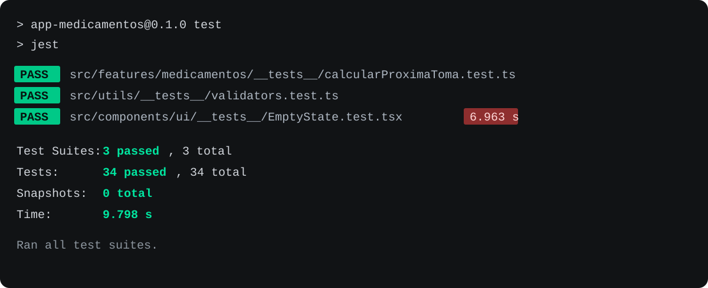
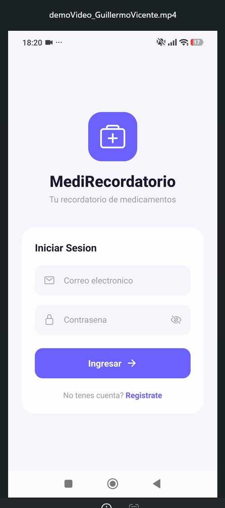
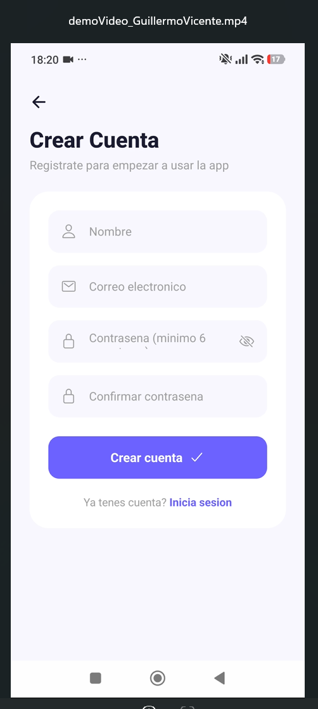
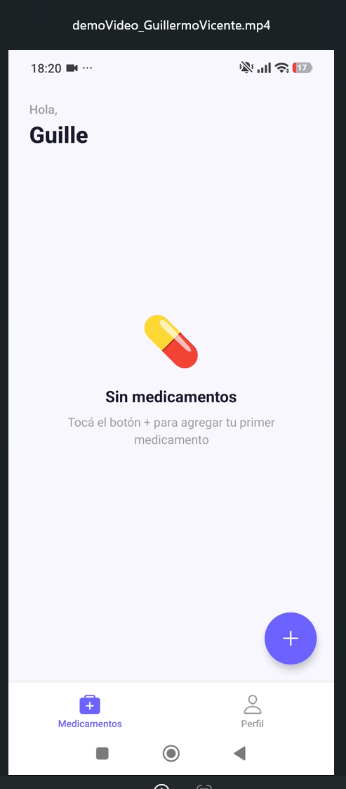
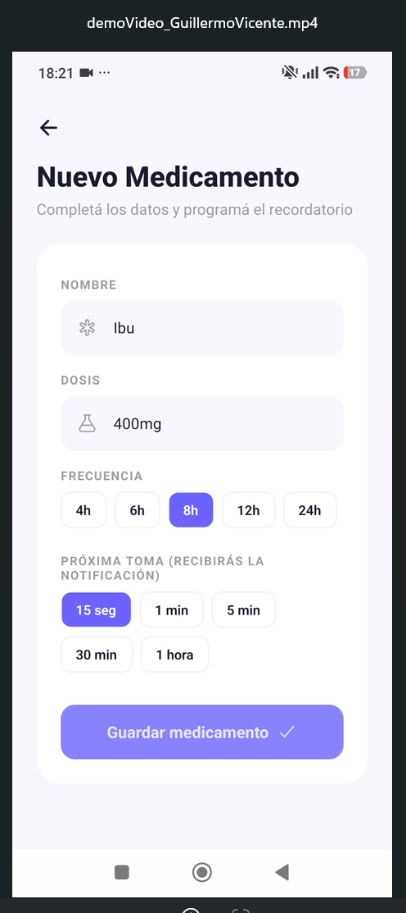
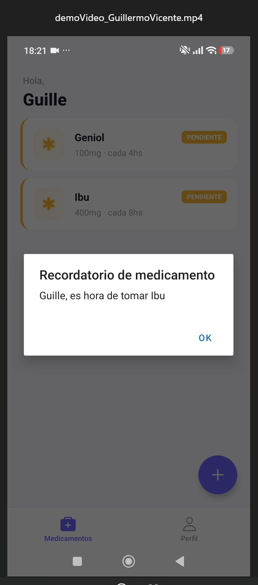
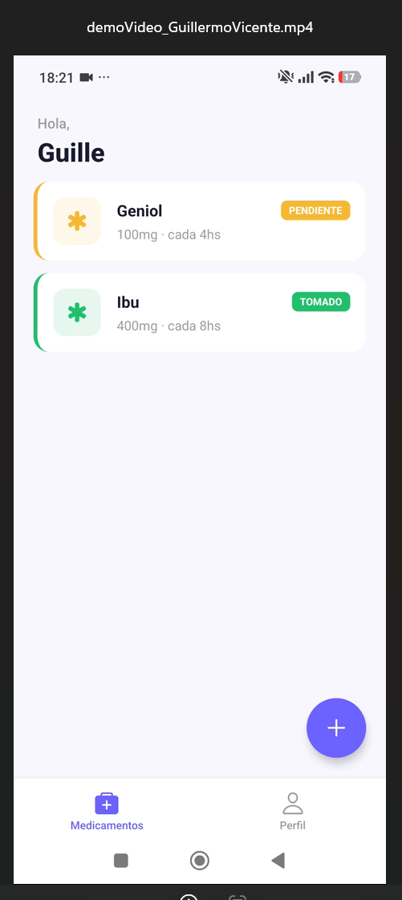
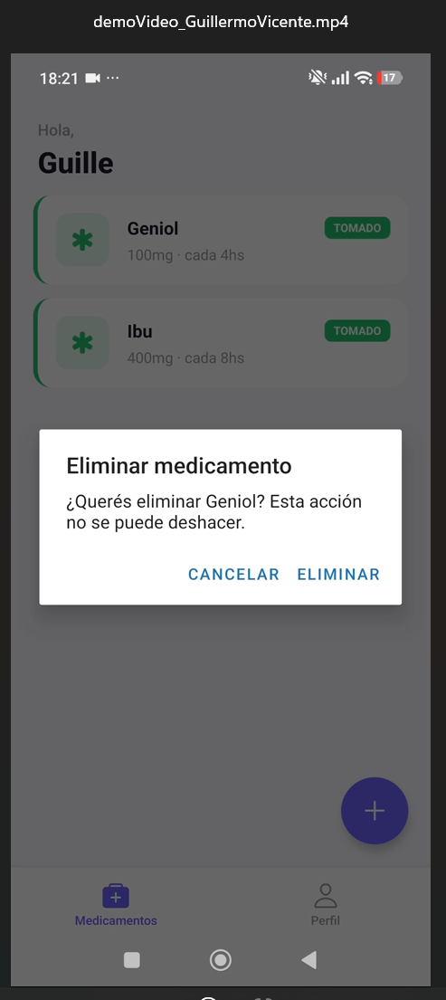
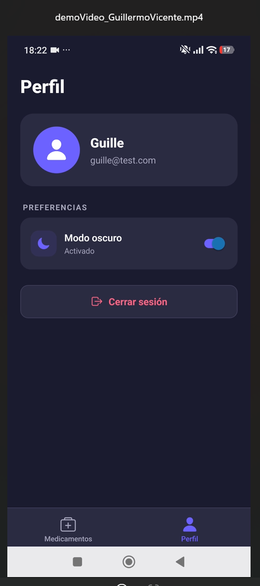

**Tecnicatura Superior en Desarrollo de Software**  
**Materia:** Aplicaciones Móviles  
**Institución:** ISTEA  
**Alumno:** Guillermo Eduardo Vicente  
**Profesor:** Martín Cornejo  

---

# MediRecordatorio

**App de recordatorio de medicación** iniciada y aprobada como Parcial 1 de **Aplicaciones Móviles** (ISTEA — 2do año, 2026), y continuada después de esa entrega.

Stack: **Expo SDK 57 · React Native 0.86 · React 19 · TypeScript 6**

---

## Opción elegida

De las 5 opciones propuestas en el parcial, elegí **Recordatorio de medicación**:

> Permitir al usuario registrar medicamentos, programar recordatorios y marcar tomas como completadas.

---

## Instalación y ejecución

### Requisitos previos

- **Node.js 18+** (recomendado 22)
- **Expo Go** instalado en el celular (Android o iOS) — [Play Store](https://play.google.com/store/apps/details?id=host.exp.exponent) / [App Store](https://apps.apple.com/app/expo-go/id982107779)
- Para conexión LAN, PC y celular en **la misma red WiFi**

### Pasos

```bash
# 1. Clonar el repositorio
git clone https://github.com/guillermo-vicente/medi-recordatorio.git
cd medi-recordatorio

# 2. Instalar dependencias
npm install

# 3. Levantar el proyecto
npx expo start --clear

# 4. Escanear el QR con Expo Go desde el celular
```

> **Si el dispositivo no conecta por la red local:**
> ```bash
> npx expo start --clear --tunnel
> ```

### Ejecutar en navegador

Para revisar la interfaz sin conectar un celular, inicia Expo para web:

```bash
npx expo start --web
```

También se puede usar `npm run web`. La vista web permite revisar colores y distribución; el teclado y las notificaciones pueden comportarse distinto que en Android o iOS.

### Verificar TypeScript

```bash
npx tsc --noEmit
```

### Pruebas automatizadas

```bash
npm test
```

Las pruebas cubren validaciones de formularios, cálculo de próximas tomas y el componente `EmptyState`.

Resultado de la ejecución de Jest: 3 suites y 34 pruebas aprobadas.



La [captura original](docs/test.png) también queda guardada en `docs/`.

---

## Funcionalidades

### Funcionalidades actuales

- Cada cuenta tiene una ficha propia y puede crear fichas locales para otras personas. Los medicamentos se asignan a una ficha y Home permite cambiar entre ellas.
- Los medicamentos admiten horarios por intervalo o por horas específicas del día, indicación opcional sobre comidas, observaciones y foto de referencia.
- Se pueden registrar tomas realizadas u omitidas, consultar el historial y ver el próximo aviso.
- Las notificaciones locales se programan según el plan cuando la plataforma y los permisos lo permiten. El aviso opcional de prueba no cambia el horario del medicamento.
- Las fotos de medicamentos y la imagen de perfil se eligen con cámara o galería, se procesan y se guardan en el dispositivo.
- Las fichas de otras personas pueden incluir un avatar; Home muestra las imágenes disponibles junto al saludo del usuario, la persona activa y cada opción del selector.
- Desde la lista de fichas de seguimiento se puede tocar un nombre para abrir en Home los medicamentos de esa persona o los propios.
- La interfaz tiene tema claro/oscuro, formularios adaptados al teclado, componentes de carga/error/vacío y etiquetas de accesibilidad en acciones principales.

### Alcance y limitaciones del prototipo

- Las cuentas y los medicamentos se guardan localmente. El modo cuidador funciona en la misma cuenta y dispositivo; todavía no hay perfiles de cuidador ni sincronización entre dispositivos.
- La autenticación es demostrativa: no existe un servidor y el token es simulado. Las contraseñas se guardan sin cifrar en AsyncStorage; en web el token usa `localStorage`. No usar datos reales de salud con este prototipo.
- Si el permiso de notificaciones se deniega, el plan se guarda pero no se programan avisos. El fallback de Expo Go usa temporizadores de la app y no es fiable si se cierra la app; las notificaciones repetidas requieren soporte nativo.
- El momento de comida y las observaciones son datos ingresados por el usuario a partir de sus indicaciones; la app no recomienda ni valida instrucciones médicas.

### Autenticación local de demostración

- Registro con nombre, email y contraseña (validación de formato y coincidencia).

- Login con validación de credenciales contra los usuarios guardados en el dispositivo.

- Sesión persistente: en móvil el token se guarda en SecureStore (Keychain iOS / Keystore Android); en web usa `localStorage`.

- Bloqueo de acceso: no se puede entrar sin loguearse.

### Medicamentos y fichas

- Alta y edición de medicamentos con dosis, horarios por intervalo o por horas diarias, indicaciones y foto opcional.

- Lista con estado de la toma (pendiente / tomada / omitida) y colores.

- Registrar una toma como realizada, con confirmación.

- Eliminar medicamento con confirmación.

- Fichas de personas en el mismo dispositivo; persistencia local aislada por cuenta.

### Notificaciones locales

- Se programa una notificación personalizada con el nombre del usuario y el medicamento al dar de alta.

- Permisos solicitados al usuario en el primer uso.

- Cancelación automática al cerrar sesión (evita alertas del usuario anterior).

### Tema claro / oscuro

- Detecta automáticamente el tema del sistema operativo.

- Toggle manual desde el Perfil.

- Sincronización con React Native Paper.

---

## Capturas

> Estas capturas documentan la interfaz presentada en el primer parcial. La app evolucionó después; las imágenes todavía no representan todas las pantallas actuales.

### Autenticación

| Login | Registro |
|---|---|
|  |  |

### Home y alta de medicamento

| Home vacío | Nuevo medicamento |
|---|---|
|  |  |

### Notificaciones y estado de tomas

| Notificación personalizada | Medicamento tomado |
|---|---|
|  |  |

### Eliminar y perfil

En Perfil, tocá el avatar para tomar una foto, elegir una imagen de la galería o quitar la foto actual. La imagen queda guardada localmente y asociada a la cuenta del dispositivo. Al tocar el nombre, volvés a Medicamentos.

| Confirmar eliminación | Perfil con modo oscuro |
|---|---|
|  |  |

---

## Estructura del proyecto

```text
AppMedicamentos/
├── app/                          # Rutas (Expo Router, file-based)
│   ├── _layout.tsx               # Stack raíz + Providers (SafeArea, Theme, Auth)
│   ├── index.tsx                 # Login
│   ├── register.tsx              # Registro
│   ├── personas.tsx              # Administración de fichas de personas
│   ├── medicamento/
│   │   ├── nuevo.tsx             # Alta y edición de medicamentos
│   │   └── [id]/historial.tsx    # Historial de tomas
│   └── (tabs)/                   # Grupo de tabs
│       ├── _layout.tsx           # Tab Navigator
│       ├── home.tsx              # Lista de medicamentos
│       └── profile.tsx           # Perfil + toggle tema + logout
│
├── src/                          # Código de la app (no rutas)
│   ├── components/ui/            # Componentes presentacionales reutilizables
│   │   ├── EmptyState.tsx
│   │   ├── ErrorState.tsx
│   │   ├── LoadingState.tsx
│   │   ├── ScreenHeader.tsx
│   │   ├── ImagePickerField.tsx
│   │   └── __tests__/
│   │       └── EmptyState.test.tsx
│   ├── config/
│   │   └── constants.ts          # Estados, frecuencias, claves de storage
│   ├── features/
│   │   ├── auth/                 # AuthContext + useAuth
│   │   ├── medicamentos/         # Datos, horarios y estado de medicamentos
│   │   │   └── __tests__/        # Pruebas de cálculos de horarios
│   │   ├── personas/             # Fichas locales
│   │   └── notifications/        # Programación y sincronización de avisos
│   ├── services/
│   │   ├── mediaService.ts       # Procesamiento y persistencia de imágenes
│   │   ├── storage.ts            # Wrapper de AsyncStorage
│   │   └── secureStorage.ts      # Wrapper de SecureStore (mobile) / localStorage (web)
│   ├── theme/                    # Tema claro/oscuro
│   └── utils/
│       ├── validators.ts         # Funciones puras de validación
│       ├── dialogs.ts            # Diálogos cross-platform
│       └── __tests__/
│           └── validators.test.ts
│
├── app.json                      # Configuración de Expo
├── package.json                  # Dependencias + scripts
├── tsconfig.json                 # Configuración de TypeScript
└── babel.config.js               # Configuración de Babel
```

---

## Stack y dependencias

| Paquete | Versión | Para qué |
|---|---|---|
| `expo` | `~57.0.25` | Framework base |
| `react-native` | `0.86.3` | Framework mobile |
| `react` | `19.2.3` | Librería de UI |
| `expo-router` | `~57.0.23` | Navegación basada en archivos (sobre React Navigation) |
| `@react-native-async-storage/async-storage` | `2.2.0` | Persistencia de datos locales |
| `expo-secure-store` | `~57.0.4` | Almacenamiento seguro del token en móvil |
| `expo-notifications` | `~57.0.21` | Notificaciones locales |
| `expo-image-picker` | `~57.0.20` | Cámara y selección desde galería |
| `expo-image-manipulator` | `~57.0.21` | Compresión y procesamiento de imágenes |
| `expo-file-system` | `~57.0.7` | Persistencia local de imágenes |
| `@expo/vector-icons` | `^15.0.3` | Íconos (Ionicons) |
| `react-native-paper` | `^5.15.0` | Componentes Material Design |
| `jest-expo` | `~57.0.5` | Preset de Jest para Expo |
| `@testing-library/react-native` | `^14.0.1` | Testing de componentes |

---

## Video de la entrega del primer parcial

> El video muestra la versión presentada en el primer parcial, anterior a varias mejoras actuales de interfaz y funcionalidades.

**[Ver video demo en YouTube](https://youtube.com/shorts/JA4iC77T3zY)**

Duración: 1:50.

Muestra el flujo completo: login → alta de medicamento → notificación personalizada → marcar tomado → modo oscuro.

## Notas técnicas

### Navegación con Expo Router

El proyecto usa expo-router, que es la capa oficial de navegación de Expo y está construida sobre React Navigation (@react-navigation/native-stack por debajo). Aporta file-based routing: cada archivo en app/ es una ruta automáticamente.

### Notificaciones locales en Expo Go Android

El proyecto usa expo-notifications con un fallback con Alert.alert cuando el módulo nativo no está disponible, manteniendo la funcionalidad del recordatorio en Expo Go. En iOS o en un development build la notificación nativa se dispara normalmente.

### Aislamiento de datos por usuario

Cada medicamento guarda el userEmail del usuario que lo creó. El servicio filtra por ese email, por lo que cada cuenta ve únicamente sus propios medicamentos.

### Pruebas incluidas

- **Funciones puras** (`validators.ts`): validan formato de email, longitud de contraseña y coincidencia de campos.
- **Componente reutilizable** (`EmptyState.tsx`): verifica su renderizado y contenido.
- **Cálculos de horarios** (`calcularTomas.ts`): cubren el cálculo de próximas tomas.
- Ejecutar con: `npm test`.
